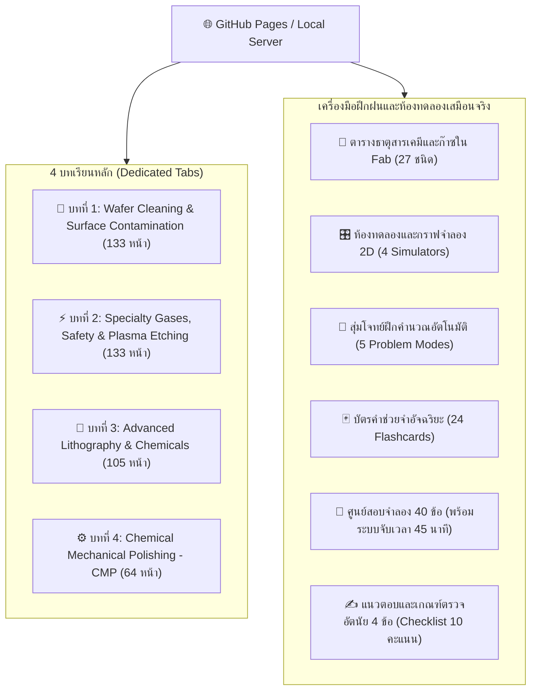

# 🔬 Semiconductor Specialty Chemicals & Gases — Final Exam Learning Portal
### ระบบการเรียนรู้และเตรียมสอบ Final ฉบับสมบูรณ์ (10 Dedicated Tabs Architecture)
**วิชา:** Specialty Chemicals and Gases for Semiconductor Devices Fabrication  
**อาจารย์ผู้สอน:** ดร. นิติ เอี่ยมถิ (Dr. Nithi Atthi — TMEC Fab Manager)  
**🌐 Live Rendered Web Portal (GitHub Pages):** [https://nicksupa.github.io/special-chem-for-semi/](https://nicksupa.github.io/special-chem-for-semi/)

---

## 📖 ภาพรวมของระบบ (Overview)

เว็บแอปพลิเคชันเพื่อการศึกษาและเตรียมสอบปลายภาคแบบ Interactive ครบวงจร ครอบคลุมทั้งข้อสอบปรนัย (40 ข้อ) และอัตนัย (4 ข้อหลัก) ตามโครงสร้างเนื้อหาของ TMEC Cleanroom Fab:



---

## 🌟 จุดเด่นของระบบ (Key Features)

1. **คลังคำอธิบายสไลด์ทุกหน้า 302 สไลด์ (L4 • L5 • L6 ครบถ้วน 100% ห้ามขาด ภาษาไทย)**: ระบบอธิบายสไลด์เจาะลึกทุกหน้า (`slides.html`) ครอบคลุม L4 (133 หน้า), L5 (105 หน้า), L6 (64 หน้า) พร้อมภาพ HD, สรุปย่อ, คำอธิบายเชิงลึก, สูตร KaTeX, และจุดเน้นข้อสอบ
2. **10 Dedicated Tabs Architecture**: แยกเนื้อหาแต่ละบทเรียนชัดเจน ไม่ปะปนกัน จัดวางแบบ Modern Card Layout สบายตา
3. **302 High-Resolution Slide Snapshots**: ภาพสไลด์จริงความละเอียดสูงครบทุกหน้า 302 ภาพ พร้อมระบบ **Image Lightbox Modal** คลิกขยายภาพใหญ่
4. **KaTeX Mathematical & Chemical Formula Engine**: เรนเดอร์สมการจลนศาสตร์และปฏิกิริยาเคมีด้วย KaTeX คมชัด
4. **4 Interactive 2D Simulators (HTML5 Canvas)**:
   - Preston Kinematics Simulator (Platen vs Carrier relative velocity $\omega_p = \omega_w \implies |\vec{V}_{rel}| = \omega R_c$)
   - Zeta Potential ($\zeta$) & DLVO Energy Barrier Curve vs pH (IEP danger threshold)
   - Rayleigh Optical Resolution ($CD = k_1 \frac{\lambda}{NA}$) & EUV Scaling
   - Plasma Etch Anisotropy Profile Simulator ($A = 1 - \frac{R_L}{R_V}$)
5. **Auto-Drill Calculation Generator**: สุ่มตัวเลขโจทย์คำนวณ 5 รูปแบบ ตรวจคำตอบอัตโนมัติ ($\pm 4\%$ tolerance) พร้อมเฉลยวิธีทำทีละขั้น
6. **Smart 3D Flashcards**: บัตรคำช่วยจำ 24 ใบ หมุน 3D พร้อม Web Audio sound effects
7. **Exam Simulator 40 MCQs**: ศูนย์สอบจับเวลา 45 นาที วิเคราะห์คะแนนแยก 4 หมวดพร้อมเฉลยละเอียด
8. **Subjective Exam Rubric (10/10 Model Answers)**: แนวตอบอัตนัย 4 ข้อแบบละเอียด พร้อมเกณฑ์การให้คะแนนแบบอินเทอร์แอคทีฟ
9. **One-Click Printable Cheat Sheet**: ปุ่มพิมพ์สรุปย่อสูตรเคมีและฟิสิกส์ลงกระดาษ A4 ในคลิกเดียว

---

## 🚀 การเปิดใช้งาน (Getting Started)

### 1. เข้าใช้งานผ่าน GitHub Pages (ออนไลน์ทันที ไม่ต้องติดตั้ง)
คลิกเข้าชมได้ทันทีที่: **[https://nicksupa.github.io/special-chem-for-semi/](https://nicksupa.github.io/special-chem-for-semi/)**

### 2. รันบนเครื่องตัวเอง (Offline Local Server)
1. Clone repository นี้:
   ```bash
   git clone https://github.com/NickSUPA/special-chem-for-semi.git
   cd special-chem-for-semi
   ```
2. ดับเบิลคลิกไฟล์ **`start_server.bat`** (หรือรันคำสั่ง `python server.py`)
3. เบราว์เซอร์จะเปิดไปที่ **`http://localhost:8080/index.html`** โดยอัตโนมัติ

---

## 📚 โครงสร้างไฟล์ใน Repository

```text
├── index.html            # เว็บแอปพลิเคชันระบบการเรียนรู้หลัก (10 Tabs, KaTeX, Tailwind)
├── slides.html           # ระบบคลังคำอธิบายสไลด์ทุกหน้า 302 สไลด์ (L4, L5, L6) ภาษาไทยละเอียด
├── slides_data.js        # ฐานข้อมูลคำอธิบายสไลด์ 302 หน้า พร้อมสูตร KaTeX และจุดเน้นข้อสอบ
├── server.py             # Python HTTP Server รองรับ Multi-threading, CORS, Auto-open browser
├── start_server.bat      # Windows batch script สำหรับเปิดเซิร์ฟเวอร์ใน 1 คลิก
├── images/               # รวมภาพสไลด์ความละเอียดสูงครบ 302 ภาพ (L4, L5, L6)
├── web_app/              # โฟลเดอร์สำรองพร้อม redirect index.html
├── L4_Specialty Chemicals...pdf     # เอกสารประกอบการสอนบทที่ 1 & 2 (133 หน้า)
├── L5_Specialty gases...pdf         # เอกสารประกอบการสอนบทที่ 3 Lithography (105 หน้า)
└── Lecture 6_CMP chemicals...pdf   # เอกสารประกอบการสอนบทที่ 4 CMP (64 หน้า)
```

---

## 👨‍🏫 เอกสารอ้างอิงและผู้จัดทำ
- **เนื้อหาการสอน:** ดร. นิติ เอี่ยมถิ (Dr. Nithi Atthi), ผู้จัดการศูนย์นวัตกรรมไมโครอิเล็กทรอนิกส์ (TMEC)
- **มาตรฐานสากล:** SEMI Standards (SEMI F63 for UPW, SEMI C Series for Process Chemicals)
- **พัฒนาโดย:** NickSUPA

